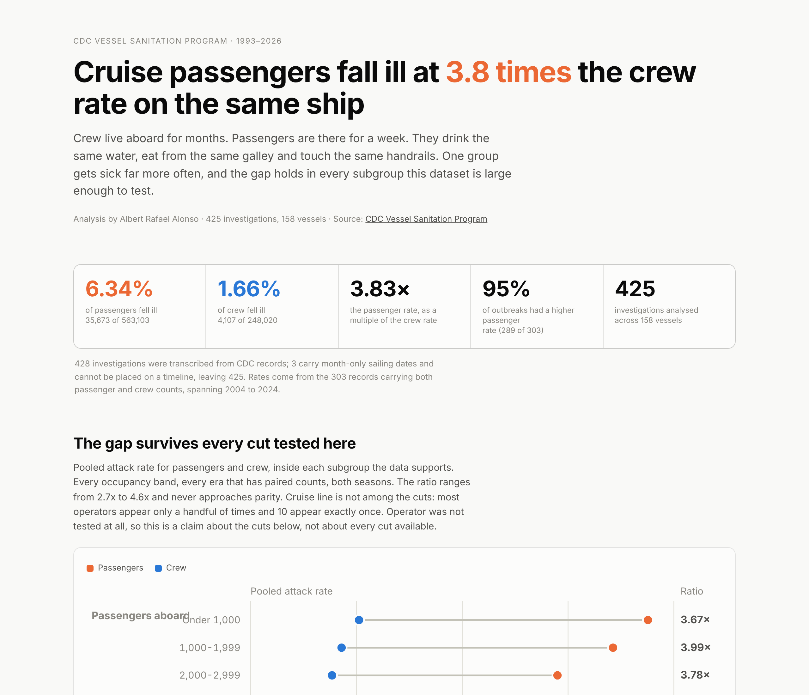

# Cruise Ship Outbreak Analysis

The industry response to a gastrointestinal outbreak is vessel-level: deep clean the ship, disinfect the surfaces, put passengers back aboard. The illness burden it is responding to is not evenly distributed.

Passengers fall ill at **3.83 times** the crew rate on the same voyages, and the gap appears in all eleven subgroups tested. Why it exists is not established here, and an uneven split is not by itself evidence against a vessel-level cause: the two groups differ in exposure duration, age structure, prior immunity and reporting incentives, and this dataset measures none of them.

Analysis of CDC Vessel Sanitation Program outbreak investigations, 1993 to July 2026.

**[Open the interactive dashboard](https://alb8rtt.github.io/cruise-outbreak-analysis/cruise_dashboard.html)**



---

## The data

**428 investigations were transcribed.** Three carry month-only sailing dates in the CDC source and cannot be placed on a timeline, so the analysis set is **425**.

CDC publishes passenger and crew counts only for closed reporting years. **303 records carry both counts**, spanning **2004 to 2024**, and every rate in this analysis comes from those. The remaining 122 are used for frequency and timing only. Nothing was estimated or imputed.

The rate window starts at 2004 for two reasons, not one. CDC's earlier pages record the vessel, the date and the outbreak but publish no crew figures at all, which accounts for **88 of the 122** unpaired records (every year from 1993 to 2003). The other **34** are spread across later years where a reporting year was still open or a count was simply absent.

Ship and cruise line names are normalized, because the CDC source spells several of them more than one way across years. The dataset covers **158 distinct vessels** across 40 operators.

---

## 1. Passengers fall ill at 3.83x the crew rate

| | Ill | Aboard | Attack rate |
| --- | --- | --- | --- |
| Passengers | 35,673 | 563,103 | **6.34%** |
| Crew | 4,107 | 248,020 | **1.66%** |

The passenger rate was higher in **289 of 303** outbreaks and lower in 14.

Pairing on the voyage holds the vessel, the sailing and the date constant. It does not hold exposure constant: the dataset carries no information on crew versus passenger water systems, galleys, accommodation or movement, and on most vessels crew messes and quarters are partly separate from passenger ones. Wilcoxon signed-rank test: p = 1.2 × 10⁻⁴⁷, rank-biserial r = 0.96, median per-voyage difference 4.11 percentage points.

**The gap holds in all eleven subgroups the data supports**, with ratios from 2.73x to 4.56x: every occupancy band, every era that has paired counts, and both seasons.

The claim is bounded to those eleven: four occupancy bands, five eras with paired counts, and two seasons. **Operator was not tested at all.** 10 of 40 operators appear exactly once in the paired set, which is too thin to say anything about, but the larger operators could have been tested and were not. Individual voyages where the crew rate is higher do exist, 14 of 303.

This is the finding the project rests on. It survives the paired signed-rank test, all eleven subgroup cuts, and the removal of any single era or occupancy band.

---

## 2. The gap is persistent, but neither group shows a significant trend

| Era | Years with counts | Paired outbreaks | Passenger rate | Crew rate | Ratio |
| --- | --- | --- | --- | --- | --- |
| 2001–2005 | 2004–2005 | 54 | 5.90% | 2.16% | 2.73x |
| 2006–2010 | 2006–2010 | 103 | 7.04% | 1.74% | 4.05x |
| 2011–2015 | 2011–2015 | 60 | 6.49% | 1.43% | 4.53x |
| 2016–2020 | 2016–2020 | 49 | 5.79% | 1.27% | 4.56x |
| 2021–2026 | 2021–2024 | 37 | 5.43% | 1.71% | 3.18x |

The crew rate fell from 2.16% to a low of 1.27% in 2016–2020, then rebounded to 1.71%. Net change across the full range is **−21%**. The passenger rate moved from 5.90% to 5.43%, **−8%**.

**Neither trend is statistically significant** across individual voyages: crew ρ = −0.097, p = 0.092; passengers ρ = +0.011, p = 0.850.

So the honest claim is narrower than it first appears. What the data shows is that the gap is present in every era that has paired counts (five of the six era bands; 1993–2000 has none) and that **no trend is detectable in either direction** for passengers over twenty-one years. p = 0.850 is an absence of evidence, not evidence of stability. What it does not show is a demonstrated downward trend in crew illness.

> **A correction worth recording.** An earlier version of this analysis reported the crew trend as significant (ρ = −0.146, p = 0.017). That figure was computed on a sample cut at 2020, which excluded the post-2020 rebound. The cut was not disclosed and it was what produced the significance. The full-sample figures above replace it. `src/analysis.py` computes everything on the full sample and prints this note.

---

## 3. Most "repeat outbreaks" are one episode counted twice

47 outbreaks began within thirty days of a previous outbreak on the same vessel. That looks like ships returning to service too early.

It is not. **38 of those 47 begin within two days of the previous voyage ending**, one more overlaps the previous investigation outright, and the median gap between the prior voyage's end and the next voyage's start is **zero days**. These are the immediately following sailing of the same weekly loop. The most economical explanation is a single outbreak spanning a turnaround, logged by CDC as two investigations.

That matters for anyone using VSP records as a frequency measure: **outbreak counts overstate the number of distinct episodes.**

There is genuine clustering beyond that, but its size depends entirely on the null you compare against:

| Window | Observed | Unrestricted shuffle | Within 3-year block | Within calendar year |
| --- | --- | --- | --- | --- |
| 30 days | 47 | 7.8 ± 2.7 (6.0x) | 17.2 ± 3.5 (2.7x) | 24.1 ± 3.7 (2.0x) |
| 60 days | 63 | 14.5 ± 3.6 (4.3x) | 30.1 ± 4.4 (2.1x) | 39.7 ± 4.2 (1.6x) |
| 90 days | 70 | 20.6 ± 4.2 (3.4x) | 40.8 ± 4.8 (1.7x) | 51.5 ± 4.4 (1.4x) |

Shuffling ship labels across the whole 1993–2026 range lets a 1997 vessel take a 2020 date, which inflates the effect. Restricting the shuffle to within a year or a three-year block is the fairer comparison. At the 90-day window, which is the defensible one, that takes a 3.4x effect down to **1.4x**. Across 2,000 permutations no shuffle under any of the three nulls reached the observed count, so p < 0.0005 is the resolution floor of the test rather than a measured value.

**The 90-day figures are the defensible ones.** The test assumes outbreaks are independent events, and at the 30-day window that assumption is weak precisely because most of those repeats are consecutive sailings.

I originally concluded from this that vessels need longer clearance windows. That conclusion is withdrawn. The data does not support it.

---

## 4. Null results, reported rather than dropped

No association between the number of passengers aboard and outbreak severity is detectable in this sample (Spearman ρ = −0.061, p = 0.292, n = 303). The same is true of voyage length (ρ = +0.020, p = 0.726, n = 302, excluding one record whose source dates are unusable). Neither result establishes that there is no relationship; at this sample size a modest one would not be detected.

Both were reasonable expectations going in. Neither held, and both are published here, because an analysis that only shows the hypotheses that worked is not evidence.

---

## What might explain the gap

The dataset contains **no protocol, immunity or demographic variable**, so everything in this section is hypothesis, not result.

Crew and passengers aboard one ship share the water supply, the galley, the ventilation and the surfaces. They differ in several ways that could each produce a gap this size:

- **Protocol.** Crew are subject to mandatory hand hygiene, food handling training and immediate isolation on reporting symptoms. Passengers are not.
- **Acquired immunity.** Crew live aboard for months and are repeatedly exposed to circulating norovirus strains. Prior exposure confers partial short-term immunity.
- **Age and population mix.** Crew skew younger than the passenger population on most itineraries.
- **Reporting.** Crew have a direct financial incentive not to report illness that removes them from paid duty.

This analysis cannot distinguish between them. Separating protocol effects from immunity and from under-reporting would require a line's internal medical logs and crew tenure data. Anyone citing this work to argue for a particular intervention is going beyond what it establishes.

---

## Limitations

**The four explanations above are not ranked.** The gap is robust; its cause is not established here.

**The investigation threshold is conditional, and it works on the two groups unequally.** CDC investigates once reported illness reaches 3% of passengers or crew, so every rate describes outbreaks that were investigated, not an illness rate across all cruises. The asymmetry matters more than the conditioning: investigations are overwhelmingly triggered by passenger illness, so the passenger rate in this sample is effectively floored near 3% by the selection rule while the crew rate is not. In the paired set, **292 of 303 passenger rates sit at or above 3%, against only 40 of 303 crew rates**. The direction of the gap is robust, but some unknown part of its *magnitude* is produced by how these outbreaks came to be investigated at all, and this analysis cannot say how much.

**The 303 voyages are not independent observations.** They cover 120 distinct vessels, and some ships recur heavily: Ryndam and Veendam appear 10 times each, 19 ships account for 124 of the records, and the project's own section 3 argues that 39 of the 47 sub-30-day repeats are not even separate episodes. The Wilcoxon and Spearman tests treat each voyage as independent, so the nominal p-values and effective sample size are optimistic. No vessel-level or operator-level random effect or clustered test was fitted. The effect size here is large enough that clustering is very unlikely to overturn the direction, but the precision is overstated.

**Rate data covers 2004 to 2024**, twenty-one years, not the full 1993–2026 span. The longer span applies only to outbreak frequency.

**The dataset has no vessel capacity field, so ship size was never tested.** What is banded and tested is `passengers_total`, the number of passengers aboard that particular sailing. 21 vessels fall in more than one band across their voyages, and Westerdam's 18-passenger 2020 sailing sits in the smallest band. Read those cuts as occupancy, not as vessel size.

**Outbreak counts by cruise line track fleet size and voyage volume.** They are not a safety ranking, and per-operator attack rates are not comparable because most operators carry only a handful of voyages.

**Seasonality is uncontrolled for exposure.** Outbreaks concentrate in December through March, but so does Caribbean sailing volume and occupancy. Without voyage counts by month, the seasonal pattern cannot be separated from seasonal exposure.

**Seven records carry a CDC *passenger* percentage that disagrees with CDC's own published counts**, from 0.12 to 6.11 percentage points. One (Grande Caribe 2008, 42.65% published as 43%) is rounding; six are substantive. The crew percentage was checked the same way and disagrees on **six further records**, including two that look like a misplaced decimal point (Norwegian Wind 2006, 1.01% published as 0.01%; Regal Princess 2006, 0.74% published as 0.07%). All thirteen are flagged in the `cdc_pax_pct_check` and `cdc_crew_pct_check` columns of `cruise_outbreaks.csv` rather than silently corrected, and every rate in this analysis is computed from the counts, never from CDC's percentage.

**Two records carry voyage dates the source cannot have meant**: one ends 23 days before it starts, and one spans a year boundary with a typo'd year. Those are flagged by `voyage_days_source_error`.

**Two further records are excluded from voyage-length statistics by a 120-day ceiling, which is a judgement call and not a source defect.** M/V Explorer's 172-day 2004 voyage is a genuine Semester at Sea sailing and Zuiderdam's 125-day 2025 voyage a Grand World Voyage. They are excluded because they are not comparable to a one-week cruise, not because the dates are wrong. Including M/V Explorer moves the voyage-length correlation to ρ = +0.027, p = 0.637, so the null holds either way. One pair of AIDAdiva 2019 records also overlaps, flagged separately.

**Records for 2019–2022** came from a public mirror of the CDC page because the CDC archive URL was unreachable at collection time. All source pages were read through model-mediated text extraction rather than direct HTML parsing; totals reconcile and outliers were spot-verified, but a cell-level recheck against raw HTML has not been done.

---

## What's here

```
cruise_dashboard.html             interactive dashboard, self-contained, light and dark
Cruise_Outbreak_Analysis.xlsx     4 tabs; the Analysis tab is formula-driven, no pasted values
cruise_outbreaks.csv              425 rows x 38 columns, one row per investigated voyage
cruise_attack_rates_long.csv      606 rows, tidy, paired voyages only
analysis_results.json             every published statistic from src/analysis.py, machine-readable
PowerBI_Build_Guide.md            step-by-step Power BI build, with the DAX
requirements.txt                  pandas, numpy, scipy, openpyxl
data/                             raw transcribed CDC records and source notes
src/prepare.py                    load, normalize, derive. Single source of truth
src/analysis.py                   every statistic quoted anywhere. Run this to reproduce
src/build_datasets.py             writes the two CSVs
src/build_workbook.py             writes the Excel workbook
src/build_dashboard.py            assembles the single-file dashboard
src/verify.py                     checks the workbook against an independent calculation
src/page_head.html                dashboard <head>, styles and theme tokens
src/page_body.html                dashboard markup and prose
src/page_script.js                dashboard charts, drawn as inline SVG
src/shot.mjs                      Playwright capture; also checks for overflow and console errors
docs/dashboard-preview.png        screenshot, for anyone not clicking through
```

To reproduce, from a fresh clone:

```
pip install -r requirements.txt
python src/analysis.py          # every published statistic, writes analysis_results.json
python src/build_datasets.py    # the two CSVs
python src/build_workbook.py    # the .xlsx
python src/build_dashboard.py   # the single-file dashboard
# --- open Cruise_Outbreak_Analysis.xlsx in Excel or LibreOffice and save it ---
python src/verify.py            # checks the workbook against an independent calculation
```

Paths resolve relative to the repository, so it runs wherever you clone it.

**The save step in the middle is required, and it is not optional housekeeping.** openpyxl writes formulas without evaluating them, so a freshly built workbook contains 6,221 formulas and no cached results. `verify.py` reads cached values, so run against an unopened build it has nothing to compare and will tell you so instead of reporting failures. Opening the file and saving it makes Excel or LibreOffice compute the formulas. Headless equivalent:

```
soffice --headless --convert-to xlsx --outdir . Cruise_Outbreak_Analysis.xlsx
```

With that step done, `verify.py` passes 46 of 46 checks and the workbook reports 0 formula errors.

The workbook's Analysis tab is built with SUMIFS, COUNTIFS, AVERAGEIFS, SUMPRODUCT, MAXIFS, MINIFS and IFERROR reading the Data tab, so adding a row updates every figure. The row *labels* are literal text: era boundaries, size bands and the cruise lines listed under Question 3 are typed, so a new era or an operator outside that list needs its label added. The Read Me tab states findings as prose, which is text, not formulas.

---

## Source

[CDC Vessel Sanitation Program outbreak investigations](https://www.cdc.gov/vessel-sanitation/cruise-ship-outbreaks/earlier-outbreaks.html)

VSP has jurisdiction over every cruise ship carrying 13 or more passengers that calls on a US port. Per-file URLs, collection dates and transcription notes are in `data/SOURCES.md`.
